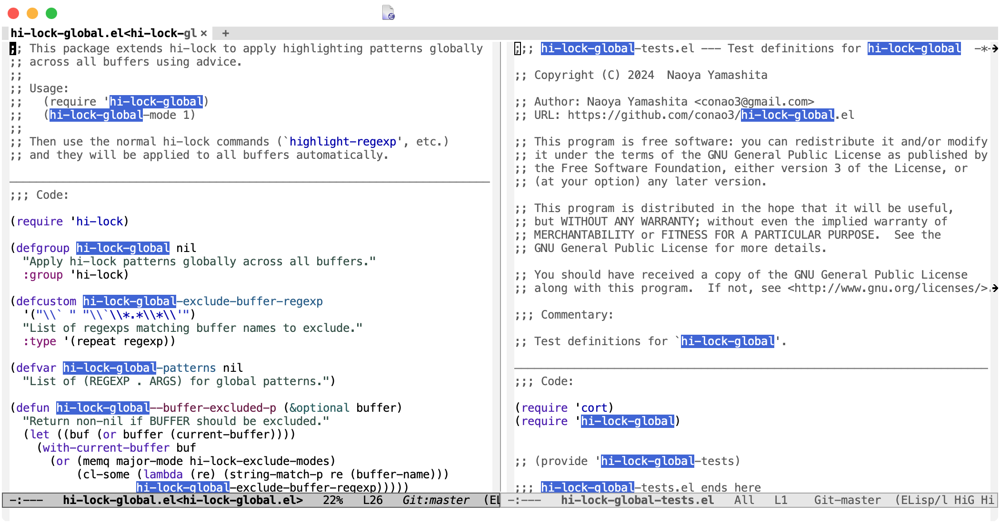

#+author: conao3
#+date: <2020-03-20 Fri>

[[https://github.com/conao3/hi-lock-global.el][https://raw.githubusercontent.com/conao3/files/master/blob/headers/png/hi-lock-global.el.png]]
[[https://github.com/conao3/hi-lock-global.el/blob/master/LICENSE][https://img.shields.io/github/license/conao3/hi-lock-global.el.svg?style=flat-square]]
[[https://github.com/conao3/hi-lock-global.el/releases][https://img.shields.io/github/tag/conao3/hi-lock-global.el.svg?style=flat-square]]
[[https://github.com/conao3/hi-lock-global.el/actions][https://github.com/conao3/hi-lock-global.el/workflows/Main%20workflow/badge.svg]]

* Description
:PROPERTIES:
:ID:       73df09c4-287f-4793-8611-c131256c8c7d
:END:

#+DOWNLOADED: screenshot @ 2026-01-26 10:15:54

Apply hi-lock patterns globally across all buffers.

When =hi-lock-global-mode= is enabled, patterns set by =highlight-regexp= and related commands are automatically applied to all existing buffers and new buffers.

* Install
#+begin_src emacs-lisp
  (leaf hi-lock-global
    :vc ( :url "https://github.com/conao3/hi-lock-global.el")
    :global-minor-mode hi-lock-global-mode)
#+end_src

* Usage
Just use the standard hi-lock commands with =hi-lock-global-mode= enabled:

- =M-x highlight-regexp=
- =M-x highlight-phrase=
- =M-x highlight-symbol-at-point=
- =M-x unhighlight-regexp=

* Customize
- =hi-lock-global-exclude-buffer-regexp= :: List of regexps for buffer names to exclude. Defaults to internal buffers (=` ...=) and special buffers (=*...*=).

* License
#+begin_example
  General Public License Version 3 (GPLv3)
  Copyright (c) Naoya Yamashita - https://conao3.com
  https://github.com/conao3/hi-lock-global.el/blob/master/LICENSE
#+end_example
